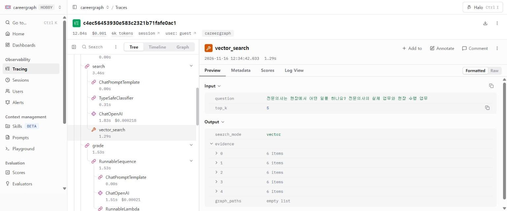
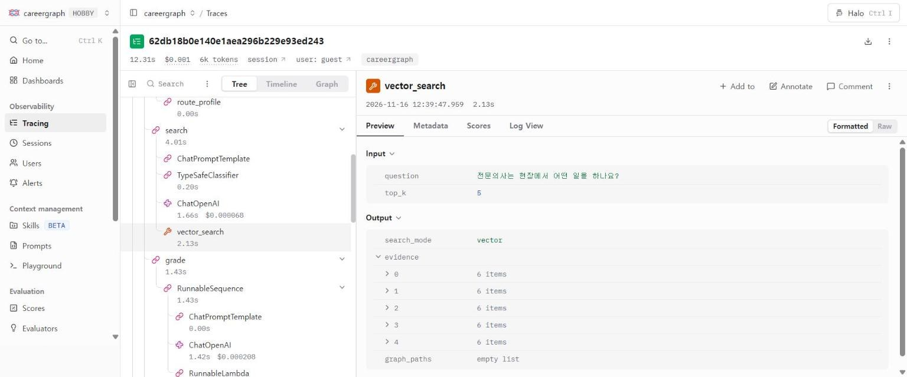
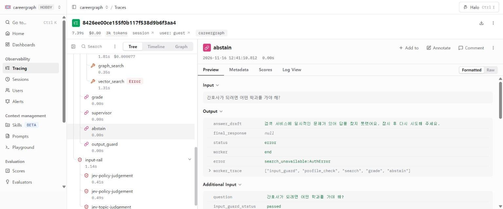

# CareerGraph Langfuse trajectory 디버깅 보고서

> 작성일 2026-11-16 · 트레이싱 구현 [app/core/tracing.py](../app/core/tracing.py) · Langfuse 프로젝트 `careergraph` (US 클라우드)
>
> 노션 요구: 재현 질문 · trace · 실패 단계 · 원인 · 수정 내용 · 수정 후 결과. 트레이스 ID는 Langfuse에서 `Tracing → 해당 ID`로 열 수 있다(로그인 필요).

## 1. 요약

| # | 사례 | 실패 단계 | 원인 | 수정 | 수정 후 |
|---|---|---|---|---|---|
| 1 | "전문의사는 현장에서 어떤 일을 하나요?"가 보류됨 | `search` → `grade`(incorrect ×2) → `abstain` | 벡터 검색이 직업명 낱말("전문")을 의미로만 처리해 엉뚱한 직업을 상위에 올림 | 질문에 직업명이 그대로 있으면 그 직업을 맨 앞에 둠 | 일반 30문항 정답 직업 재현율 29/30 → **30/30** |
| 2 | 검색 서비스 오류가 "근거 부족" 보류로 표시됨 | `search`(예외/오류) → `abstain` | 오류와 근거 부족을 같은 `abstain` 경로로 처리하고 오류 표시를 지움 | 오류 상태를 유지하고 오류 안내로 종료 | 상태 `error`, 안내 문구 분리, 테스트 5개 |
| 3 | 정상 질문이 입력 레일에서 막힘 | `input-rail`의 `jev-policy-judgement` | 정책 글 끝에 덧붙인 허용 문장이 위반 확률을 올림 | 문장을 빼고 IN-03 설명만 좁힘 | 위반 확률 0.52 → 0.06, 입력 273/273 정답 |

사례 3은 Langfuse 연결 전에 같은 판정 확률을 직접 호출해 잡은 것이라 트레이스는 없고, 화면으로는 Jev 판정 입출력(`jev-policy-judgement`)으로 같은 확인을 할 수 있다.

## 2. 사례 1 — 전문의사 질문이 보류된 이유

### 재현 질문
`전문의사는 현장에서 어떤 일을 하나요?` (평가셋 EVAL007, 일반 카테고리)

### 증상
RAGAS 실행(`output/eval/ragas_20261116_crag/agent_results.jsonl`)에서 이 질문만 일반 30문항 중 유일하게 보류됐다. 최종 답변 "현재 자료만으로는 답변을 확정하기 어렵습니다".

### trajectory (실패한 실행의 `search_history`)
```
input_guard → profile_check → search(vector) → grade → rewrite → search(vector) → grade → abstain → output_guard
                               후보 5개            incorrect(쓸 근거 0)      후보 5개          incorrect
```
- 1차·2차 모두 후보가 `항공우주공학기술자`, `전통식품제조원` 등 **전문의사와 무관한 직업**이었다.
- `grade`는 정확하게 "쓸 근거 없음(incorrect)"으로 판정했다. 즉 **근거 평가는 정상이고, 그 앞의 검색이 실패한 것**이다.

### 원인 분석
1. 데이터에는 `전문의사`가 있다(`job:25`, `CAREER0014`)고 Neo4j에서 확인했다. 업무 설명 임베딩도 있다.
2. 벡터 검색만 직접 호출해 보면 같은 질문의 상위 5개는 `시장 및 여론조사전문가`, `기자`, `마케팅전문가`, `텔레마케터`, `번역가`였다. `전문의사` 낱말의 "전문"을 의미로 읽어 `…전문가`류 직업을 가까이 둔다. 질문 `전문의사가 하는 일`, `전문의사 업무`도 같았다.
3. 반면 업무 내용을 풀어 쓴 질문("환자의 병 원인을 찾아 치료하고 수련 의사를 교육하는 직업")은 1위가 `전문의사`였다. **직업명으로 묻는 질문에서 업무 설명 임베딩이 약하다.**
4. 이 증상은 실행마다 다르다. 검색 워커(GPT)가 도구 인자 `question`을 매번 다르게 쓰기 때문이다.

### Langfuse로 확인한 것 (수정 전, 우연히 성공한 실행)
트레이스 `c4ec56453930e583c2321b71fafe0ac1` — 같은 질문이 이번에는 성공했다. `vector_search` 도구 입력을 보면 GPT가 질문 뒤에 설명을 덧붙였다.



`question = "전문의사는 현장에서 어떤 일을 하나요? 전문의사의 실제 업무와 현장 수행 업무"`. 덧붙은 문구가 임베딩을 바꿔 `전문의사`가 걸렸을 뿐, 근본 원인이 해결된 것은 아니다. **트레이스가 없었다면 "가끔 실패한다"로만 보였을 문제를 도구 입력 차이로 설명할 수 있게 된 사례**다.

### 수정
[app/tools/search.py](../app/tools/search.py) `_vector_search`: 질문에 직업명이 그대로 들어 있으면(3글자 이상, 긴 이름 우선, 최대 3개) 그 직업의 업무 설명을 벡터 결과 앞에 둔다. 두 글자 이하("기자", "검사")는 다른 낱말 안에서 우연히 맞을 수 있어 제외했다. 직업명 조회가 실패해도 벡터 결과는 그대로 쓴다.

### 수정 후 결과
| 확인 | 수정 전 | 수정 후 |
|---|---|---|
| `전문의사는 현장에서 어떤 일을 하나요?` 벡터 상위 1개 | 시장 및 여론조사전문가 | **전문의사** |
| 일반 30문항 벡터 검색의 정답 직업 재현율 | 29/30 | **30/30** |
| 직업명이 없는 질문("의사는 어떤 일을 하나요?") | 한의사, 치과의사, 일반의사… | 같음(영향 없음) |
| 단위 테스트 | – | `tests/test_exact_name_search.py` 3개 통과 (정확 일치 앞 배치·중복 제거, 벡터 순서 유지, 조회 실패 시 안전) |

수정 후 트레이스 `62db18b0e140e1aea296b229e93ed243`: 이번에는 GPT가 질문을 그대로 넘겼는데도(덧붙임 없음) 근거가 `CAREER0014:work`로 잡혀 `grade correct → supported`로 끝났다.



### 남은 한계
- 정확 일치는 질문에 직업명이 **글자 그대로** 있을 때만 작동한다. 띄어쓰기나 줄임말 차이는 못 잡는다.
- 근본적으로는 임베딩 입력에 직업명을 함께 넣는 방식(`직업명: …\n하는 일: …`)이 인계서에 있지만 질문 쪽은 질문 문장 그대로다. 재임베딩은 비용과 데이터 변경이 필요해 이번 범위에서 제외했다.

## 3. 사례 2 — 서비스 오류가 "근거 부족"으로 처리됨

### 재현
Neo4j 비밀번호를 틀리게 해서(`NEO4J_PASSWORD=wrong-password-for-test`, 로컬 실행에서만) 아무 직업 질문을 한다: `간호사가 되려면 어떤 학과를 가야 해?`

### 수정 전 동작 (코드 근거)
- 검색 분류가 두 번 실패하면 `search_node`가 빈 근거 + 오류 문자열을 `search_result`에 넣고 근거 부족처럼 이어갔다.
- `profile_check` 판정 오류는 `abstain` 노드로 가면서 `abstain_node`가 `error: None`, `status: "abstain"`으로 덮어썼다.
- 결과: 사용자에게는 "현재 자료만으로는 답변을 확정하기 어렵습니다"(근거 부족)가 나가고, 상태 기록상 오류였다는 흔적이 사라졌다. **다시 시도하면 되는 오류가 "자료가 없는 질문"으로 오해된다.**

### 수정
[app/graph/nodes.py](../app/graph/nodes.py): 검색 분류 2회 실패 + 벡터 대체 검색도 빈 결과면 `search_routing_failed`, 벡터 검색 자체가 예외면 `search_unavailable:<예외>` 오류로 끝낸다. Supervisor는 오류가 있으면 재검색 없이 `abstain` 노드로 보내고, `abstain_node`는 오류를 유지하며 "검색 서비스에 일시적인 문제가 있어 답을 찾지 못했어요. 잠시 후 다시 시도해 주세요."를 낸다. 고정 오류 문구는 출력 레일을 거치지 않는다(가드 상태 `skipped`).

### 수정 후 trajectory (트레이스 `8426ee00ce155f0b117f538d9b6f3aa4`)
```
input_guard(passed) → profile_check → search → vector_search [Error] → grade(건너뜀) → supervisor → abstain(status=error) → output_guard(skipped)
```



- `vector_search`에 **Error 표시**가 붙고, `abstain` 노드 출력에 `status: error`, `error: search_unavailable:AuthError`가 남는다.
- `grade`는 평가 모델을 부르지 않아 비용 0(0.00s)이다.

| 확인 | 수정 전 | 수정 후 |
|---|---|---|
| 상태 | `abstain` | **`error`** |
| 오류 기록 | 지워짐 | `search_unavailable:AuthError` 유지 |
| 사용자 안내 | 근거 부족 문구 | 서비스 오류 + 재시도 안내 |
| 테스트 | – | `tests/test_graph_guard_flow.py` 5개 (프로필 판정 오류, 근거 부족 구분, 분류 실패+빈 대체, 벡터 예외, 숨은 지시 근거 제거) |

## 4. 사례 3 — 입력 정책 문장 때문에 정상 질문이 막힘

- **증상:** 가드레일에 "본인 ID를 적은 질문은 IN-03이 아니다"라는 허용 문장을 `input_policy` 끝에 붙였더니 `간호사가 되려면 어떻게 해야 하나요?`가 입력 레일에서 차단됐다.
- **trajectory:** `input_guard → input-rail → jev-policy-judgement` 한 번에서 `probability 0.52`(기준 0.5)로 `blocked`.
- **원인:** 같은 판정 입력에서 정책 글만 바꿔 비교했다(허용 문장 있음 0.52 / 없음 0.06). Jev가 정책 글 끝의 별도 문장을 위반 후보로 함께 읽었다.
- **수정:** 그 문장을 빼고 IN-03 설명 자체를 "`selected_user_id`가 아닌 다른 회원의…"으로 좁혔다. 질문 판정에는 선택한 회원 ID를 함께 넘겼다.
- **수정 후:** 정상 질문 0.06, "U001 내 이메일 주소 알려줘"(U001 선택)는 통과, 타인 ID 요청은 계속 차단. 입력 273건 전부 정답([가드레일 명세서](CareerGraph_Guardrails_적용명세서.md)). 지금은 `jev-policy-judgement` 입력·출력을 Langfuse에서 바로 볼 수 있다.

## 5. Langfuse로 디버깅하는 순서

1. **Tracing**에서 사용자·세션·태그(`careergraph`)로 거르고 질문 입력으로 트레이스를 찾는다.
2. **Graph 보기**로 어느 노드를 몇 번 거쳤는지 본다(재작성 루프, 오류 분기).
3. 이상한 노드를 눌러 **입력·출력**을 본다. 검색이면 `vector_search`/`graph_search` 도구 입력(질문, Cypher)과 반환 근거, 평가면 `grade` 출력, 가드레일이면 `jev-*` 확률.
4. 원인을 코드나 정책에서 고치고, 같은 질문으로 새 트레이스를 만들어 **수정 전후**를 비교한다.
5. 같은 증상을 막는 테스트를 추가한다.

## 6. 한계
- 수정 전 트레이스는 사례 1에서 "우연히 성공한 실행"뿐이고 실패한 실행의 트레이스는 남기지 못했다(RAGAS 실행 시 트레이싱을 붙이지 않았다). 실패 trajectory는 평가 기록의 `search_history`로 재구성했다.
- 사례 2의 "수정 전" 트레이스는 없다(트레이싱 도입과 수정이 같은 시기). 수정 전 동작은 코드와 상태값으로 설명했다.
- 입력 질문과 답변은 개인정보를 가린 뒤 전송한다(화면의 질문 일부가 `[전화번호]` 등으로 보일 수 있다).
