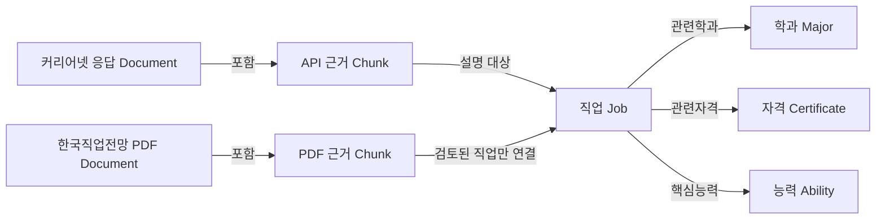

# CareerGraph 프로젝트 검토 요청

**주제:** 근거 기반 진로정보 탐색 GraphRAG  
**예상 개발 기간:** 약 5일  
**문서 작성일:** 2026-11-09  
**문서 목적:** 프로젝트 아이디어, 수집한 데이터, 그래프 온톨로지의 초기 설계가 단위 프로젝트 요구사항에 적합한지 검토받기 위한 자료

> 현재 직업 데이터와 그래프 적재용 파일, 평가 질문 초안은 준비했습니다. Neo4j 적재, 검색 시스템, 에이전트, UI, 품질·안전 평가의 동작은 아직 검증하지 않았습니다.

## 1. 프로젝트 아이디어

CareerGraph는 **학과·직업·관련 자격·핵심능력의 관계를 탐색하고, 공공 진로정보 자료를 근거로 답변하는 한국어 GraphRAG 서비스**입니다.

사용자가 학과 또는 직업에 관해 질문하면, 질문 유형에 따라 관계 그래프와 원문 검색을 사용합니다. 여러 관계를 거쳐야 하는 질문에는 탐색 경로를 제시하고, 원문이 부족하거나 모순되면 답변을 제한하는 것을 목표로 합니다.

### 해결하려는 문제

- 직업의 업무, 관련 학과, 자격 및 능력 정보를 한 번에 비교하기 어렵습니다.
- 학과에서 관련 직업을 찾고 다시 그 직업의 자격·능력을 비교하려면 여러 정보를 연결해야 합니다.
- ‘관련 자격’이 ‘필수 자격’으로 잘못 전달되거나, 특정 학과가 취업을 보장하는 것처럼 설명될 수 있습니다.
- 답변이 어떤 API 응답과 문서 구절을 근거로 하는지 확인할 필요가 있습니다.

### 예상 사용자와 활용 예

진로를 탐색하는 학생이나 학습자가 학과와 직업의 관계, 업무 내용, 준비에 참고할 정보를 찾는 상황을 가정합니다. 취업 가능성이나 자격 취득의 필요 여부를 개인별로 확정하는 서비스는 제공하지 않습니다.

| 질문 유형 | 시연 질문 예시 | 기대 동작 |
|---|---|---|
| 일반 질문 | “일기예보관은 어떤 일을 하나요?” | 원문을 검색해 업무를 요약하고 출처를 표시 |
| 관계 질문 | “대기과학과와 관련된 직업은 무엇인가요?” | 학과에서 연결된 직업을 탐색하고 관계 근거 제시 |
| Multi-hop | “대기과학과와 관련된 일기예보관의 관련 자격과 핵심능력은 무엇인가요?” | 학과 → 직업 → 자격·능력 경로와 원문 근거 제시 |
| 근거 검증 | “일기예보관에게 기상기사는 반드시 필요한가요?” | 관련 자격 목록과 자격 안내 설명을 함께 확인 |
| 근거 부족 | “이 학과를 졸업하면 특정 기업에 반드시 취업하나요?” | 취업을 보장할 근거가 없음을 설명하고 확정을 보류 |

위 질문은 기획·평가 초안입니다. 최종 시연 전 질문별 정답과 원문 근거를 다시 검토할 예정입니다.

## 2. 수집한 데이터

### 2.1 커리어넷 직업백과 API — 주 데이터

- 출처: [커리어넷 직업백과 Open API 명세](https://www.career.go.kr/cnet/front/openapi/jobCenter.do)
- 수집 기준일: 2026-11-08. 이 날짜에 확인된 API 전체 목록 **552개 직업**을 기준으로 했습니다.
- 원본 상세 응답, 정리된 직업·관계 파일과 출처 필드 위치를 보존했습니다.
- 기존에 확보한 50개 상세 응답은 재사용했습니다.

| 항목 | 수집 결과 | 활용 |
|---|---:|---|
| 직업 | 552개 | 직업 노드 및 업무 설명 검색 |
| 관련 학과 원본 관계 | 2,101행 | 직업–학과 연결 |
| 관련 자격 원본 관계 | 1,205행 | 직업–자격 연결 |
| 핵심능력 원본 관계 | 764행 | 직업–능력 연결 |
| 원본 관계 합계 | 4,070행 | API 응답에서 추출한 관계 |
| 중복 제거 후 적재용 관계 | 4,061개 | 그래프 적재용. 원본 중복 9행은 원본 파일에 보존 |

수집한 주요 필드는 직업 코드·직업명, 하는 일, 관련 학과 ID·이름, 관련 자격, 핵심능력, 자격 안내, 교육·훈련·입직 설명입니다. API의 직업 수정일과 수집일을 구분해 보존했습니다.

**빈 데이터도 있습니다.** 552개 중 관련 학과가 비어 있는 직업은 66개, 관련 자격이 비어 있는 직업은 198개입니다. 빈 값은 API 응답에 정보가 없다는 뜻으로 취급하며, 관계가 현실에서 존재하지 않는다고 단정하지 않습니다.

### 2.2 한국직업전망 PDF — 설명 근거 보강

- 출처: [한국고용정보원 「2023 한국직업전망」 자료 안내](https://www.data.go.kr/data/15140285/fileData.do)
- 자료 형태: 2023년판 PDF, **668쪽**.
- 활용 목적: 업무, 되는 길, 관련 자격·학과, 직업 전망 설명을 추가 근거로 사용.
- 페이지별 텍스트 청크 **2,013개**를 생성했으며, 이 중 기존에 직업 대응을 검토한 **14개 직업의 청크 180개**를 검색 후보 자료에 연결했습니다.
- 이전 검토 표본 50개 직업의 PDF 대응은 동일 명칭·업무 확인 11개, 동등성 검토 3개, 부분 대응 14개, 미대응 22개입니다. 동등성 판단은 팀의 검토이며 공식 직업 ID 대응표는 아닙니다.
- 나머지 직업에 대해서는 이름 유사도로 후보를 만들었으나 **원문 검토 전 자동 연결하지 않았습니다.**

PDF의 발행연도와 전망 기준기간은 현재 수집일과 다릅니다. API 직업과 PDF 직업이 이름만 비슷한 경우 직무 범위를 확인한 후 연결하며, 부분 대응은 동일 직업의 전체 근거로 취급하지 않습니다. 자료 안내 페이지에 표시된 이용 조건은 **출처표시·상업적 이용금지(공공누리 제2유형)**입니다.

### 2.3 현재 데이터 준비 및 검증 상태

| 산출물 | 현재 상태 |
|---|---|
| 직업·학과·자격·능력 노드 파일 | **1,541개 노드**로 정리 |
| 그래프 관계 파일 | **4,061개 관계**로 정리 |
| 검색용 근거 청크 | API 6,798개 + 검토된 PDF 연결 180개 = **6,978개** |
| 관계와 API 원문 대조 | 원본 관계 4,070행을 해당 API 필드와 대조, 불일치 0건 |
| 평가 질문 | **41개 초안**. 정답·근거와 질문의 적절성은 팀 검토 필요 |
| 그래프 DB·벡터 인덱스 | 적재용 데이터 준비. **실제 적재 및 검색 성능 검증 전** |

API 출처 주소는 키를 제거한 식별 주소이므로 그대로 클릭해 원문이 표시되는 링크라고 보장할 수 없습니다. 실제 API 근거는 보존한 원본 응답 파일과 필드 위치로 추적합니다. PDF는 원문 제공 주소와 PDF 페이지·인용 구절을 제시할 계획입니다.

## 3. 기초 그래프 온톨로지

### 3.1 핵심 개념

초기에는 커리어넷에서 **직접 확인되는 관계**를 중심으로 구성합니다.

```text
직업 ─관련학과→ 학과
직업 ─관련자격→ 자격
직업 ─핵심능력→ 능력
```

학과를 기준으로 질문하면 관계를 역방향으로 탐색합니다.

```text
학과 ←관련학과─ 직업 ─관련자격→ 자격
                    └─핵심능력→ 능력
```

예상 Multi-hop 경로:

```text
대기과학과 ←관련학과─ 일기예보관 ─관련자격→ 기상기사
대기과학과 ←관련학과─ 일기예보관 ─핵심능력→ 수리·논리력
```

이 관계는 관련 정보를 보여 주며, 기상기사가 반드시 필요한 자격이라는 의미는 아닙니다. 필수 여부를 질문하면 별도의 자격 안내 원문을 확인해야 합니다.

### 3.2 노드 설계

| 노드 | 의미 | 식별 및 주요 속성 | 상태 |
|---|---|---|---|
| `Job` | 직업 | 커리어넷 `job_code`, 직업명, 직업군 | 적재용 파일 준비: 552개 |
| `Major` | 관련 학과 | 커리어넷 학과 ID, 학과명 | 적재용 파일 준비: 405개 |
| `Certificate` | 관련 자격 | 자격명 기반 식별자, 원래 자격명 | 적재용 파일 준비: 573개 |
| `Ability` | 핵심능력 | 능력명 기반 식별자, 원래 능력명 | 적재용 파일 준비: 11개 |
| `Document` | API 응답 또는 PDF 판본 | 제목, 출처, 발행연도, 수집일, 버전 | **추가 설계** |
| `Chunk` | 검색·인용에 사용할 원문 구간 | 본문, 원문 필드 또는 PDF 페이지, 청크 ID | 검색 청크 파일 준비. 그래프 노드화는 **추가 설계** |

직업과 학과는 API가 제공한 ID를 우선 사용합니다. 자격·능력에 공식 ID가 없는 경우 현재 적재용 데이터는 이름 기반 식별자를 사용하며, 다른 표기의 동일 대상이나 이름이 비슷한 다른 대상을 자동으로 합치지 않습니다.

### 3.3 관계 설계

| 출발 노드 | 관계 | 도착 노드 | 데이터 근거 | 상태 |
|---|---|---|---|---|
| `Job` | `RELATED_MAJOR` 관련 학과 | `Major` | `departList`의 학과 ID·이름 | 적재용 관계 준비 |
| `Job` | `RELATED_CERTIFICATE` 관련 자격 | `Certificate` | `certiList` | 적재용 관계 준비 |
| `Job` | `HAS_CORE_ABILITY` 핵심능력 | `Ability` | `abilityList` | 적재용 관계 준비 |
| `Document` | `HAS_CHUNK` 포함 | `Chunk` | API 필드 또는 PDF 페이지에서 추출한 구간 | **추가 설계** |
| `Chunk` | `DESCRIBES` 설명 대상 | `Job` | API 직업 ID 또는 검토된 PDF 직업 대응 | **추가 설계** |

현재 `graph_edges.csv`에는 직업–학과·자격·능력의 3종 관계가 있으며, 원본 응답 파일명과 필드 위치를 보존합니다. `Document`·`Chunk` 노드 및 근거 관계는 아래와 같이 구현할 계획입니다. 현재 파일에 이 노드·관계가 이미 적재되어 있는 것은 아닙니다.



### 3.4 원문과 관계를 연결하는 방식

- 각 그래프 관계에 출처 문서 또는 원본 응답, API 필드명, 수집일을 연결합니다.
- PDF는 문서 ID, PDF 페이지, 인용 구절, 직업 매핑 상태를 보존합니다.
- 같은 관계를 여러 자료에서 확인하면 출처를 덮어쓰지 않고 각각의 근거를 유지합니다.
- API의 직업과 PDF 직업이 `exact` 또는 검토된 `verified_equivalent`인 경우에만 동일 직업의 설명 근거로 연결하는 방안을 적용합니다. `partial`·`unmatched`는 자동 연결하지 않습니다.
- API 응답의 `curriculum`은 직업 준비를 위한 교육 설명입니다. 학과의 실제 교과목 목록으로 해석하지 않습니다.

## 4. 예상 시스템 동작

```text
Streamlit 질문 입력
  → NeMo Guardrails 입력 정책 확인
  → LangGraph Supervisor가 질문 유형과 검색 경로 판단
  → 벡터 검색 / 그래프 탐색 / 결합 검색
  → 추론 에이전트가 관계 경로와 원문을 사용해 답변 초안 작성
  → 검증 에이전트가 주장·출처·부족 여부 확인
  → 필요 시 재검색 또는 답변 보류
  → 출력 정책 확인 후 출처·경로·답변을 UI에 표시
```

| 구성 | 구현 계획 |
|---|---|
| 벡터 검색 | 직업의 업무·교육·자격 안내 및 검토된 PDF 설명 검색 |
| 그래프 검색 | 직업–학과·자격·능력 관계 및 Multi-hop 경로 탐색 |
| 결합 검색 | 관계를 찾은 뒤 해당 직업의 설명과 자격 안내를 함께 검색 |
| Supervisor | 검색·추론·검증 에이전트의 분기, 재검색 및 종료 결정 |
| 근거 검증 | 주요 주장과 검색 근거 대조. 자료 부족·충돌 시 재검색 또는 보류 |
| Streamlit | 질문, 사용한 검색 방식, 관계 경로, 원문 출처, 답변 또는 보류 사유 표시 |
| Langfuse | 실행 경로, 실패 단계 및 수정 전후 trace 확인 |

위 구성은 **구현 계획**입니다. 검색 방식의 정확도나 그래프 결합의 성능 향상은 아직 측정하지 않았습니다.

## 5. 평가 및 제출 계획

### 평가 질문 초안: 41개

| 유형 | 수 | 확인할 내용 |
|---|---:|---|
| 일반 | 8 | 직업 설명과 원문 출처 |
| Multi-hop | 10 | 학과 → 직업 → 자격·능력 경로 |
| 관계 비교 | 5 | 두 직업과 공통 학과의 연결 |
| PDF 근거 | 4 | 직업 대응, PDF 페이지·인용 구절 |
| 근거 부족 | 6 | 정보 부재를 명시하고 답변 제한 |
| 안전 차단 | 3 | 위험 요청에 대한 제한 |
| 안전 정상 허용 | 3 | 정상 진로 질문의 오탐 여부 |
| 범위 외 입력 | 1 | 서비스 범위 안내 |
| 가상 근거 충돌 | 1 | 서로 충돌하는 근거에 대한 보류 |
| **합계** | **41** | |

평가 질문에는 기대 경로, 대상 직업 코드, 근거, 기대 동작과 참고 답변을 기록했습니다. 다만 초안은 초기 50개 직업을 기반으로 작성되어 전체 552개 기준으로 질문과 정답의 적합성을 다시 검토해야 합니다. 가상 충돌 문서는 테스트 시에만 별도 주입하고 실제 원문으로 취급하지 않습니다.

### 측정 계획

1. 동일한 질문과 생성 모델·설정으로 **벡터 검색 기준선**과 **그래프 결합 검색**을 비교합니다.
2. 검색에 필요한 근거를 찾았는지와 답변이 근거를 충실히 사용했는지를 구분해 기록합니다.
3. RAGAS **Faithfulness**와 **Answer Relevancy**를 측정하고 표본 수·설정·대표 오류를 공개합니다.
4. NeMo Guardrails의 정상 허용·무관 요청·위험 요청 시나리오에서 기대 결과와 실제 결과, 오탐·누락을 기록합니다.
5. 근거 부족으로 보류하는 것이 정답인 질문은 RAGAS 점수만으로 판단하지 않고 보류 정책을 별도로 평가합니다.
6. Langfuse trace로 라우팅·검색·검증 실패 사례와 수정 전후 결과를 기록합니다.

**현재 위 평가는 실행 전입니다.** 평가 점수나 그래프 결합의 개선 효과를 주장할 단계는 아닙니다.

## 6. 현재 제약과 의사결정이 필요한 부분

1. 전체 552개 직업 중 2023판 PDF에 대응하는 항목을 모두 검증한 상태는 아닙니다. 현재는 이전 표본의 검토된 14개 직업만 연결했습니다.
2. PDF 청킹 과정에서 문장이나 표가 나뉘거나 읽기 순서가 달라질 수 있어, 시연용 원문과 페이지를 재확인해야 합니다.
3. API에 빈 값이 있거나 오래된 조사 기반 설명이 있을 수 있습니다. 수집일·수정일·원문 조사연도를 구분해야 합니다.
4. 학과–직업–자격 경로는 **관련성**을 나타냅니다. 자격의 필수 여부, 특정 학과 졸업의 취업 보장, 개인별 합격 확률을 의미하지 않습니다.
5. 그래프 노드와 관계는 적재용 파일 단계입니다. Neo4j의 실제 경로 탐색, 벡터 인덱스, LangGraph, UI 및 품질·안전성 평가는 별도 구현이 필요합니다.
6. 5일 일정에서는 전체 데이터의 PDF 매핑을 무리하게 확장하기보다, 검토된 관계와 대표 질문에 대한 검색–검증–평가 흐름을 완성할 계획입니다.

## 7. 강사님께 검토받고 싶은 사항

1. **주제 적합성:** 학과·직업·자격·능력 관계를 활용한 진로정보 서비스가 GraphRAG 단위 프로젝트 주제로 적절한가요?
2. **Multi-hop 설계:** `학과 → 직업 → 관련 자격/핵심능력` 경로가 필수 요구사항의 Multi-hop 시연에 충분한가요? 보완할 질문 유형이 있을까요?
3. **온톨로지 범위:** 초기에는 직업·학과·자격·능력과 문서 근거를 중심으로 구성하려고 합니다. 추가하거나 구분해야 할 핵심 노드·관계가 있을까요?
4. **자료 결합:** 커리어넷을 주 데이터로 사용하고, 직업 범위가 검증된 한국직업전망 PDF만 근거로 결합하는 방식이 적절한가요?
5. **데이터 규모:** API 직업 552개 전체를 활용하되, PDF는 현재 검토된 14개 직업을 우선 사용하는 범위가 적절한가요?
6. **평가 방식:** 현재 41개 질문 초안을 바탕으로 벡터 기준선·결합 검색 비교, RAGAS, 안전·보류 테스트를 진행하려고 합니다. 평가셋 구성과 규모에서 보완할 점이 있을까요?
7. **5일 일정:** 필수 기능을 유지하면서 데이터 매핑과 고급 기능의 범위를 어떻게 조정하면 좋을까요?

## 8. 준비한 파일

프로젝트 폴더: `C:\Users\Playdata\Desktop\CareerGraph`

| 파일 | 내용 |
|---|---|
| `expanded_20261108/jobs.csv` | 커리어넷 직업 552개 |
| `expanded_20261108/relations.csv` | API에서 추출한 원본 관계 4,070행 |
| `expanded_20261108/graph_nodes.csv` | 그래프 적재용 노드 |
| `expanded_20261108/graph_edges.csv` | 중복 제거한 그래프 적재용 관계 |
| `expanded_20261108/retrieval_chunks.json` | API·검토된 PDF 검색 근거 청크 |
| `eval/evaluation_draft.csv` | 평가 문항 240개와 기대 엔티티·경로·근거 |
| `expanded_20261108/pdf_mapping_candidates_review.csv` | PDF 직업 연결을 위한 미검토 후보 |
| `expanded_20261108/validation.json` | 데이터·관계·참조 검증 기록 |
| `expanded_20261108/데이터_평가셋_안내.md` | 수집 범위와 파일 사용법·한계 |

공유 시에는 프로젝트 폴더의 `.env`와 API 인증키가 포함되지 않도록 확인합니다.
