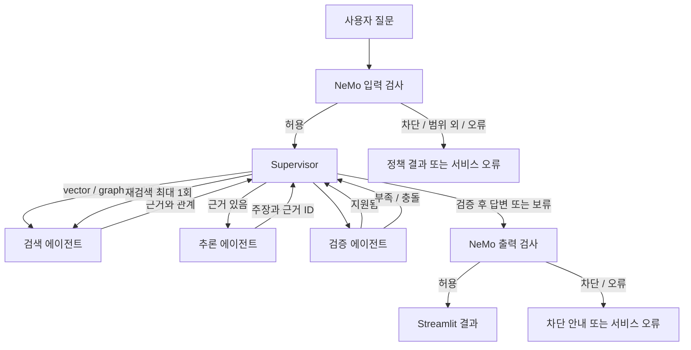

# CareerGraph 에이전트 상세 설계

작성일: 2026-11-10  
상태: **구현 전 설계**. 실제 호출·성능·배포 검증 결과가 아니다.

관련 문서: [기초 시스템 설계도](CareerGraph_기초_시스템_설계도.md) · [NeMo Guardrails 상세 설계](CareerGraph_NeMo_Guardrails_상세설계.md)

## 1. 목적과 설계 원칙

질문에 필요한 검색 경로를 고르고, 검색·추론·근거 검증 에이전트가 협력해 **근거가 있는 진로정보 또는 보류 사유**를 반환한다. LangGraph Supervisor 패턴은 필수이며, Supervisor가 역할별 에이전트를 실제로 호출하고 결과에 따라 다음 단계를 결정한다.

각 에이전트를 별도 서버나 별도 모델로 운영할 필요는 없다. Streamlit Community Cloud의 한 Python 프로세스에서 역할과 권한이 분리된 에이전트로 구성하고, 필요하면 같은 OpenAI 모델을 공유한다. AuraDB Free와 OpenAI API, Langfuse Cloud 연결은 모두 외부 서비스의 실제 사용 조건을 확인한다.

## 2. 전체 흐름

Supervisor는 자율적으로 검사·정책 단계를 생략할 수 없다. NeMo 입력·출력 경계와 ‘검증 후에만 답변 전달’은 그래프 바깥 또는 그래프의 필수 노드에서 강제한다. 도구·검색 결과와 PDF 텍스트는 **근거 데이터**이며 시스템 지시나 권한을 부여하지 않는다.

## 3. 에이전트별 역할과 계약

### 3.1 Supervisor

| 항목 | 설계 |
|---|---|
| 책임 | 질문 및 현재 상태를 보고 검색 경로와 다음 에이전트를 선택 |
| 호출 대상 | 검색, 추론, 검증 에이전트 |
| 입력 | 입력 정책 결과, 사용자 질문, 이전 단계 결과, 재검색 횟수·오류 |
| 출력 | 검색 경로 `vector`·`graph`·`hybrid`, 다음 역할, 최종 답변/보류 결정 |
| 제약 | 근거 검증 생략 금지, 재검색 최대 1회, 단계 수와 모델 호출 상한 적용 |

권장 방식은 LangGraph의 상태 그래프에서 Supervisor가 역할별 호출과 반환을 관리하는 방식이다. 구체적 구현 방식은 팀이 고정한 LangGraph 버전에서 검증한다. 별도 `langgraph-supervisor` 패키지는 필수로 가정하지 않는다. [LangChain의 Supervisor 패턴 안내](https://docs.langchain.com/oss/python/langchain/multi-agent/subagents)

### 3.2 검색 에이전트

| 항목 | 설계 |
|---|---|
| 책임 | 질문과 경로에 맞는 그래프 관계·문서 청크 검색 |
| 입력 | 질문, 경로, 추출된 엔터티 후보와 식별자 |
| 도구 | 읽기 전용 그래프 탐색, 벡터 검색, 원본 근거 조회 |
| 출력 | 엔터티 후보, 관계 경로, 근거 ID·인용 구절·출처, 검색 오류 |

`vector`는 직업 업무·준비 설명, `graph`는 학과·직업·자격·능력 관계, `hybrid`는 관계 탐색 후 해당 직업의 설명 검색에 사용한다. 엔터티가 여러 개면 후보를 남기고 임의로 단정하지 않는다. 검색된 관계가 있다고 자동으로 필수 자격이라는 결론을 내리지 않는다.

Cypher는 허용된 읽기 전용 쿼리 유형과 파라미터를 우선 사용한다. 자유 생성 쿼리를 채택하는 경우라도 쓰기 구문·관리 명령을 차단하고, 읽기 전용 DB 권한, 깊이·결과 수·시간 제한을 함께 적용한다. 인용 근거로 쓰는 그래프 관계는 `graph_edges.csv`의 원본 파일 및 필드까지 확인할 수 있어야 한다. 현재 검색 청크에 학과·자격·능력 목록이 이미 포함되어 있다고 가정하지 않는다.

### 3.3 추론 에이전트

| 항목 | 설계 |
|---|---|
| 책임 | 허용된 검색 결과로 질문에 대한 답변 초안 작성 |
| 입력 | 질문, 관계 경로, 문서·관계 근거 |
| 출력 | 문장 또는 주장별 내용과 해당 근거 ID, 답변에 필요한 미확인 항목 |
| 금지 | 근거 없는 수치·직업 관계 생성, 관련 자격을 필수 자격으로 바꾸기 |

출처가 없는 주장은 별도로 표시하여 검증 단계에 넘긴다. 검색 데이터 안의 지시문을 도구 실행이나 상위 정책으로 따르지 않는다. PDF 기준연도와 API 수집일을 구분한다.

### 3.4 검증 에이전트

| 항목 | 설계 |
|---|---|
| 책임 | 답변의 주요 주장과 근거를 대조하고 부족·충돌을 판단 |
| 입력 | 질문, 주장별 초안·근거 ID, 실제 원문과 관계 |
| 출력 | 주장별 `supported`·`insufficient`·`conflict`, 검토 사유, 재검색 또는 보류 권고 |
| 제한 | 원문과 ID의 실제 연결을 확인하며, 모델의 자기 평가만으로 통과시키지 않음 |

관계의 존재와 사실 설명을 구분해 확인한다. 그래프 경로에는 원본 관계 필드가, 설명 주장에는 원문 구절이 있어야 한다. PDF는 직업 매핑과 페이지가 실제로 대응하는지 확인한다. 판단이 불확실하면 `supported`가 아니라 `insufficient`로 처리한다. 초기 검증 기준과 임계값은 실험 전 고정하고 평가 결과에 맞춰 사후 변경하지 않는다.

## 4. 공통 상태와 데이터 형식

다음은 **논리적 계약**이며 실제 클래스나 코드가 아니다.

| 상태 항목 | 의미 |
|---|---|
| `request_id`, `trace_id` | 한 질문의 실행과 trace 연결 |
| `question`, `policy_input` | 질문과 NeMo 입력 검사 결과 |
| `route`, `entities` | 선택한 검색 방식과 식별된 엔터티 후보·ID |
| `evidence`, `graph_paths` | 검색 청크·관계 경로와 근거 ID |
| `draft_claims`, `verification` | 주장별 초안과 검증 결과 |
| `retry_count`, `step_count` | 재검색 횟수와 전체 단계 수 |
| `status`, `error` | 실행 상태와 비밀정보를 제거한 오류 유형 |
| `policy_output`, `final_response` | NeMo 출력 검사와 최종 응답 |

**근거 레코드**에는 `evidence_id`, 유형(API 관계·API 설명·PDF), 문서명·제공기관, `job_code`, 원문 구절, `source_field` 또는 `pdf_page`, 원본 파일 식별자, 수정일·발행연도가 필요하다. API 키를 제거한 API URL은 출처 식별자이며 공개 원문 링크라고 표시하지 않는다.

**주장 레코드**에는 주장 내용, 참조 근거 ID 목록과 검증 결과가 필요하다. 참조 ID가 없거나 실제 근거를 찾지 못하면 사용자에게 단정적인 사실로 표시하지 않는다.

## 5. 분기·종료·오류 정책

| 조건 | 동작 | 사용자에게 표시 |
|---|---|---|
| 일반 설명 질문 | 벡터 검색 → 추론 → 검증 | 출처가 있는 답변 |
| 단순 관계 질문 | 그래프 검색 → 필요 시 근거 조회 → 검증 | 관계 경로와 원문 필드 |
| 관계와 설명을 함께 요구 | 그래프 + 벡터 → 추론 → 검증 | Multi-hop 경로와 각 주장 근거 |
| 근거 부족 또는 식별 실패 | 경로를 보완해 최대 1회 재검색 | 부족이 유지되면 현재 자료 기준 보류 |
| 자료 간 충돌 | 출처·연도·대상 범위 비교, 필요 시 1회 재검색 | 충돌 근거와 보류 사유 |
| AuraDB·OpenAI 오류 | 재검색 카운트와 구분해 오류 상태 반환 | 서비스 오류. ‘자료에 없음’으로 표시하지 않음 |
| NeMo 차단·검사 실패 | 가드레일 설계의 정책 적용 | 안전 차단 또는 검사 불가 상태 |

전체 단계 상한은 구현 시 낮은 값으로 정해 무한 루프를 방지한다. 상한·시간 제한에 도달하면 검증되지 않은 초안을 노출하지 않고 안전한 서비스 안내를 반환한다. 정상 답변과 보류 안내 모두 최종 출력 검사를 거친다. NeMo가 동작하지 않을 때의 처리와 예외는 별도 가드레일 문서의 단일 계약을 따른다.

### 5.1 NeMo 수정 결과와 검사 누락

NeMo 입력·출력 검사가 `MODIFIED`를 반환하거나 검사 대상·필수 rail이 빠진 경우를 자동 허용으로 처리하지 않는다. 초기 정책은 입력 수정 시 재질문 안내, 출력 수정 시 초안을 표시하지 않는 안전한 보류다. 수정된 출력을 사용할 경우에는 변경된 내용의 주장·출처와 출력 정책을 다시 검증하고 반복 횟수를 제한해야 한다. NeMo 세부 상태와 장애 처리의 단일 기준은 [가드레일 상세 설계](CareerGraph_NeMo_Guardrails_상세설계.md)를 따른다.

## 6. 실행 시나리오

### 시나리오 A: 설명 질문

1. 입력 검사에서 정상 질문을 허용한다.
2. Supervisor가 `vector`를 선택해 검색 에이전트를 호출한다.
3. 추론 에이전트가 직업 업무를 요약하고 근거 ID를 연결한다.
4. 검증 에이전트가 각 주장의 원문 일치를 확인한다.
5. 출력 검사를 통과한 답변과 출처를 표시한다.

### 시나리오 B: Multi-hop

1. 학과와 직업 후보의 이름·ID를 확인한다.
2. 그래프에서 학과 ← 직업 → 자격·능력 경로를 찾는다.
3. 자격 필수 여부 등 설명이 필요한 경우 해당 직업 원문을 추가 검색한다.
4. 경로별 API 필드와 문서 구절을 검증한 뒤 답한다.

### 시나리오 C: 근거 부족과 오류 구분

- 자료 검색이 정상 종료됐지만 취업 보장을 뒷받침하는 근거가 없으면 재검색 후 보류한다.
- AuraDB가 중지되어 검색 자체가 실패하면 시스템 오류로 안내한다. 성공한 검색에서의 근거 부족으로 위장하지 않는다.

## 7. 평가 및 관측

- 기존 41개 평가 초안을 552개 직업 범위와 실제 원문을 기준으로 검토하고 질문·정답·기대 경로·근거를 고정한다.
- 동일 질문·모델·데이터·컨텍스트 예산에서 벡터 전용 기준선과 Supervisor 결합 검색을 비교한다.
- 라우팅 정확성, 근거 검색 성공, 경로·출처 검증, 재검색·보류 결과를 질문별로 기록한다. 답변 품질은 RAGAS Faithfulness·Answer Relevancy를 별도 측정한다.
- Langfuse trace에는 Supervisor 결정, 역할별 시작·종료, 검색 경로·근거 ID, 검증 판정, 정책 결과, 오류 유형, 시간·호출량을 연결한다. API 키와 불필요한 민감정보는 저장하지 않는다. [Langfuse LangGraph 연동](https://langfuse.com/integrations/frameworks/langgraph)
- 검증 가능한 trajectory 실패 1건 이상에 대해 같은 질문의 수정 전후 trace와 결과를 비교한다.

## 8. 리소스와 구현 우선순위

1. 세 역할이 실제로 Supervisor에 의해 호출되고 상태를 반환하는 최소 흐름을 만든다.
2. 쿼리별 검색 결과 수, 관계 깊이, 컨텍스트 토큰·모델 호출 횟수, 재검색 횟수를 제한한다. 구체적 수치는 측정 후 설정하며 팀의 비용 한도를 따른다.
3. 데이터베이스 드라이버 등은 안전하게 재사용하되 사용자별 상태·대화는 공유하지 않는다.
4. 전체 인덱싱은 오프라인에서 수행한다. 웹 앱의 요청 또는 rerun에서 전체 데이터를 재처리하지 않는다.
5. Community Cloud에서 실제 의존성 설치·메모리·콜드 스타트·동시 질문을 테스트한다. 배포 적합성은 현재 미검증이다.

## 9. 완료 기준

- Supervisor가 검색·추론·검증 역할을 실제로 호출하고 각 결과를 반영한다.
- 일반·관계·Multi-hop·근거 부족·안전·서비스 오류 시나리오의 실제 실행 경로가 기대와 일치한다.
- 재검색은 1회 이하이며, 지원되지 않는 주장과 오류가 검증된 답변으로 표시되지 않는다.
- 관계 원본 필드·API 원문·PDF 페이지에 도달할 수 있는 출처가 있다.
- Langfuse에서 수정 전후 trajectory를 확인하고 평가 결과·미해결 오류를 기록한다.
- NeMo 입력·출력 정책은 별도 문서의 검증 절차를 통과한다.
